Amman, Jordan

 

&nbsp;

 

## About

Full stack development student, five months into an intensive program — building and publishing projects as I learn. My current focus is semantic HTML, responsive CSS layouts, and component-based design with Bootstrap, before moving into JavaScript and backend development.

I believe in strong fundamentals, readable code, and consistent daily practice. Every repository on this profile documents a step of that progress.

## Skills

| Area | Technologies |
|------|--------------|
| Frontend |    |
| Currently learning |  |
| On the roadmap |   |

## Goals

- Complete my full stack program with a portfolio of real, working projects
- Build strong JavaScript fundamentals through daily practice
- Grow into a job-ready full stack developer

## GitHub Activity

