<div align="center">


<br>


<br><br>


</div>

## Tech Stack

<div align="center">

**Working with**


<br><br><br>

**Learning next**


</div>

## About

```text
zayn@pond ~ % cat about.txt

Full Stack Web Development student — 5 months in, building daily
Fundamentals first: semantic HTML, responsive layouts, clean code
Goal: job-ready full stack developer
One lily pad at a time — progress over perfection
```

## My GitHub History

<div align="center">


<br><br>


<br><br>


</div>

<div align="center">


</div>
